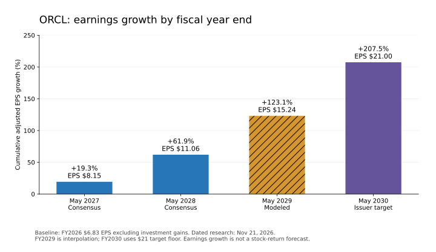

# Oracle: growth, capital conversion and per-share value

Dated research snapshot: November 21, 2026. USD, NYSE common stock. Market closed. Historical reference price **$103.2954**, last trade November 20 at 19:59:57 ET, from an earlier Massive retrieval (M01); not refreshed or eligible as a live/executable quote. This is a source-reviewed research draft on issue75/PR77, not integrated production analysis. Every source ID resolves in [sources.json](sources.json); exact original-document hashes and independent financial acceptance remain unavailable.

## 1. Investment conclusion and competing explanations

**Oracle has two different economic engines:** enterprise data/applications with recurring workflows and an expanding AI infrastructure business requiring large, timed capital commitments. The attractive outcome is not merely more GPUs or a larger backlog. It is higher recurring earnings and distributable cash per diluted share after customer acceptance, equipment replacement, financing and leases.

Our judgment: database and application integration are the more durable moat; capacity execution is the faster potential growth engine and the greater balance-sheet risk. The stock can remain inexpensive on adjusted forward EPS while cash risk is correctly priced. Conversely, synchronized billing, stable high-margin enterprise businesses and reduced funding uncertainty could support a higher multiple. Neither explanation is established by a low P/E alone.

Four competing hypotheses should remain open: (H1) durable profitable capacity conversion; (H2) valuable legacy earnings plus a slower but viable AI build; (H3) temporary reported growth supported by prepayments, capitalized costs or exclusions; (H4) a financing/acceptance mismatch that permanently damages equity value. The watch plan below states evidence that distinguishes them; there are no assigned probabilities.

## 2. Revenue and profit map

Q1FY2027, ended August31, reported revenue was $19.345B. Rounded product disclosures: IaaS $7.4B (+121% YoY), SaaS $4.2B (+10%); software $5.550B, hardware $0.774B and services $1.414B. IaaS/SaaS comprise cloud, not additional revenue to add to cloud. Health, database and AI themes cross reported lines and lack a complete standalone profit bridge. [S02]

| Economic stream | Buyer/value delivered | Earnings mechanism | Main limitation |
|---|---|---|---|
| OCI AI/CPU infrastructure | Model developers, enterprises and sovereign operators buy compute/network/storage | Accepted capacity becomes billable consumption or contracted service | Construction, hardware, power, rent, depreciation, customer credit and pricing |
| Database/support/multicloud | Enterprise customers preserve transaction systems while modernizing | Support retention; database subscriptions and consumption | Migration can cannibalize legacy support; rival databases reduce new-workload capture |
| Fusion applications / NetSuite | Finance, HR, supply chain and smaller-enterprise workflow buyers | Subscriptions, expansion and potentially incremental consumption | AI bundled into existing products may improve retention without separate upsell |
| Health / industry applications | Hospitals, clinicians and regulated-industry users | Workflow/cloud migration and service attachment | Deployment quality, clinical trust, implementation costs and sector procurement |
| Services and hardware | Implementation and installed-system support | Enables product adoption and specialized systems | Not all revenue has software-like margin or repeatability |

Do not value every incremental revenue dollar at a software margin. Independently reported product gross profit, retention, customer concentration and geographic economics would improve the analysis; missing measurements remain null rather than assigned favorable scores.

## 3. Strategic partnerships and revenue transmission

| Counterparty / channel | Evidence and stage | Oracle monetization path | What must be verified |
|---|---|---|---|
| OpenAI infrastructure | November20 Oracle statement says its own contract-delivery funding is in place [S09] | Capacity acceptance, billings and collection | Executed pricing/security, timing, cancellation and customer payment capacity; funding is not payment insurance |
| OpenAI enterprise products | October27 collaboration covers models, ChatGPT and Codex across Oracle enterprise offerings [S13] | Workflow adoption, data use and potential paid consumption | Availability by product, usage-to-paid conversion, model cost and who owns customer distribution |
| NVIDIA | October27 announcement describes Vera Rubin/Vera availability and planned further scale [S14] | Sell compute/services using purchased accelerator platforms and Oracle integration | Delivered racks vs announced capacity, networking reliability, price/performance and margin after supplier cost |
| AMD | October2025 plan calls for initial50,000 MI450 deployment starting Q3CY2026 [S15] | Alternative accelerator/CPU offering and customer choice | Current installed/accepted supply not independently established in this review; announced dates are not delivery receipts |
| AWS | August13 counterpart announcement supports Exascale availability and expanded collaboration [S16] | Oracle-managed database services purchased through AWS distribution | Recognized incremental Oracle profit, revenue sharing, customer migration and cannibalization |
| Microsoft Azure | November17 counterpart announcement expands enterprise-data/agent integrations; distinguishes preview features [S17] | Place Oracle data nearer Azure applications and AI workflows | Preview-to-production, paid use, renewal and channel economics |
| Google Cloud | Oracle multicloud/public-sector plan includes Google Cloud [S18] | Database distribution into an existing cloud estate | Product/region availability, completed certification and incremental economics |
| Alloy operators / sovereign partners | Oracle describes partner-branded operation and partner-held customer relationship [S21] | Platform/service economics with local distribution | Oracle's share of revenue/cost/risk; do not book operator end-customer revenue as Oracle revenue |
| Integrators and industry ecosystem | Implementation/channel category; no new quantified contract added here | Reduce migration friction and support deployments | Named signed scope, acceptance, recurring attachment and margins |

IBM remains an enterprise comparison in this package; no new IBM partnership is asserted. Partners can also compete: Azure/AWS/Google own alternative databases, NVIDIA captures supplier economics, and OpenAI distribution can intermediate the application interface. A partner logo is not an exclusive moat.

## 4. Leadership and governance assessment

Roles reviewed: Larry Ellison is chairman/CTO; Clay Magouyrk and Mike Sicilia are co-CEOs. Safra Catz became executive vice chair in September2025. Hilary Maxson became CFO April6,2026 after Schneider Electric finance leadership. [S10-S12]

| Dimension | Assessment (analyst judgment) | Evidence to retain / falsifier |
|---|---|---|
| Infrastructure execution | Demonstrated product/scale capability, but capital-cycle outcome unproven | Magouyrk's OCI background; test accepted/billable capacity, availability and cash rather than deployments alone |
| Industry/application execution | Relevant operational experience; monetization still needs proof | Sicilia's industry background; test renewals, Health adoption and paid AI expansion |
| Capital allocation | Appropriate CFO experience for energy/infrastructure transition; results pending | Maxson's background; test returns after all funding, lease and replacement obligations |
| Strategic continuity | Founder-led product direction plus long-tenured successors | Risk of concentrated decisions, overcommitment and insufficient independent challenge |
| Shareholder alignment | Ownership aligns upside but does not remove governance risk | Proxy records concentrated insider ownership and413M Ellison shares pledged; dated disclosure is not evidence of a current margin call [S11] |

No composite leadership score is justified by these inputs. Compensation tied to adjusted operating growth should be reviewed alongside diluted-share cash returns; awards can reward expansion without equivalent distributable value. Quality must be judged by forecast accuracy, transparent revisions, uptime/customer outcomes, returns on incremental investment and willingness to stop unattractive projects.

## 5. Internal technology, innovation and technical limits

**Database engineering:** 26ai documentation includes integrated vector/relational functionality. The economic opportunity is to use governed operational data without a separate data-copying stack; actual advantage depends on workload, latency, governance and cost. Availability is version/platform dependent; technical documentation is not an independent performance benchmark. [S19]

**OCI integration:** Oracle supplies a cloud/software/network operating layer around third-party accelerators and networking. The NVIDIA collaboration combines vendor platforms with Oracle's Acceleron integration. This may improve delivered cluster economics but does not make Oracle the owner of CUDA or GPU silicon IP. [S14]

**Application agents:** Fusion Agent Studio supports workflow orchestration and governance. The issuer says the studio is available at no additional cost, so the model must not automatically add a separate AI license fee. Hypotheses are retention, increased workflow penetration, consumption and reduced implementation friction; pricing and unit costs require measurement. [S20]

**Clinical workflows:** the UK Clinical AI Agent announcement describes availability and named NHS deployments. That is evidence of product commercialization, not independent proof of better outcomes or broad standalone profit. Integration, approval controls, reliability and clinician acceptance matter. [S22]

**Model choice and distribution:** OpenAI integration can shorten product-development cycles while increasing external model/API dependence. The strongest proprietary value may remain permissions, data semantics, transaction workflows and operational reliability, rather than a uniquely superior foundation model. Emerging robotics/automation can create indirect database/compute demand; no direct robotics revenue line or quantum contribution is included without evidence.

## 6. Moat and competitive erosion

| Layer | Why it can endure (hypothesis) | Erosion test |
|---|---|---|
| Mission-critical databases | Application dependencies, operational risk and accumulated know-how make migration costly | Net new workload share, migrations to PostgreSQL/cloud-native alternatives, support pricing and churn |
| Enterprise applications | Embedded financial/HR/supply-chain processes, controls and integrations | SAP/Workday/Salesforce and agent-led workflow alternatives win budgets; per-seat monetization weakens |
| Exadata/multicloud | Integrated database performance and ability to follow customers into other clouds | Channel partner captures economics, migration savings disappoint or alternative databases are good enough |
| AI infrastructure | Delivered power, networking, operational competence and contractual customer relationships | Hardware availability broadens, customers diversify suppliers, performance or financing advantage narrows |
| Sovereign/regulated delivery | Residency/control and locally operated distribution address procurement barriers | Certifications stall, local rules change, compliance/service costs exceed premium |

This is a qualitative moat assessment, not measured market share. AI can strengthen Oracle by making its data more valuable, while weakening seat-based applications and reducing the cost of writing substitutes. Both channels must remain in the thesis.

## 7. TAM expansion: serviceable profit, not headline spending

A reliable additive dollar TAM is **not established**. Use a bottom-up map; do not add infrastructure spend, database spend and downstream AI application revenue as if they were independent end-customer budgets.

| Opportunity | Expansion mechanism | Procurement/economic gate | Measurement needed |
|---|---|---|---|
| Training/inference | Larger models, agents and enterprise inference need more services | Accepted powered capacity and economically viable contracts | Billable capacity, revenue per accepted cohort, customer credit and cash return |
| Multicloud databases | Customers modernize where applications already run | Migration wins and Oracle share after partner terms | Migrated workload count, paid consumption, retention and legacy cannibalization |
| Agentic workflows | More tasks and transactions per customer | Incremental willingness to pay exceeds inference/support cost | Paid expansion, automated workflow volumes, reliability and gross profit |
| Sovereign/regulated cloud | Local data/control requirements open additional buyers | Local delivery and certification | Deployed regions, accepted workloads and Oracle's net economics |
| Public-sector multicloud | Government database modernization | October27 release is a certification plan, not completed approval [S18] | Authorization status, procurement awards and billings |
| Health/industry | Ambient documentation and workflow modernization | Clinical/operational acceptance and implementation quality | Adoption/renewals, cost-to-serve and segment cash contribution |

Analyst framework: serviceable revenue = qualified buyer budget * addressable share * implementation/adoption * Oracle capture. Profit adds margin and subtracts operating cost; equity value adds reinvestment, financing, taxes and dilution. Unknown coefficients stay unknown. No externally quoted TAM CAGR is silently translated into Oracle EPS growth.

## 8. FY2026-FY2030 earnings and valuation ladder

The following is the **same dated series** used earlier, refreshed against S06 where available. Consensus is vendor-adjusted; detailed forward GAAP reconciliation is unavailable. FY2029 is an equal-growth interpolation, not independently verified consensus. FY2030 is the floor of management's target. Historical quote reference M01 is fixed; these are fiscal-year multiples, not rolling NTM.

| Fiscal end | Adjusted EPS | YoY growth | Cumulative vs FY26 ex-gain6.83 | P/E at103.2954 | Origin | Annual results |
|---|---:|---:|---:|---:|---|---|
| May31,2026 |7.63|26.5%|Not comparable: includes gains|13.54x historical|Actual [S01,S24]|June10,2026 actual|
| May31,2027 |8.15|6.8%;19.3% vs ex-gain base|19.3%|12.67x|Consensus [S06]; issuer guide8.10 [S04]|June2027 estimated|
| May31,2028 |11.06|35.7%|61.9%|9.34x|Consensus [S06]|June2028 estimated|
| May31,2029 |15.24|37.8%|123.1%|6.78x|Modeled geometric bridge|June2029 estimated|
| May31,2030 |21.00|37.8% vs modeledFY29|207.5%|4.92x|Issuer target floor [S04]|June2030 estimated|

FY26 reported GAAP EPS5.83 gives17.72x that year's earnings at the same reference price. Forward GAAP EPS/P-E remain null. FY26 adjusted excluding investment gains6.83 grew13.3% over FY25 adjusted6.03. Reported adjusted7.63 includes the gains; it must not imply a collapse in recurring FY27 growth. FY27 consensus range8.00-8.60 and FY28 range9.00-12.77 show disagreement, not probability bounds. [S01,S06]

The next Q2FY27 report is December14,2026 per the official FAQ search extract; direct HTML did not expose its expanded text, so recheck the formal announcement before scheduling. Q2 consensus1.89; Q3 March2027 window2.02; Q4 June2027 window2.34. Future exact dates are unannounced in this review. [S23,S06]

## 9. Financing and the $21 feasibility bridge

The November equity offering is86,206,897 common shares at116. Prospectus pro forma common outstanding3.110B uses the August31 base, not a new fully diluted weighted average. Scheduled January15,2029 preferred conversion adds approximately25-31M shares, leaving3.135-3.141B before subsequent employee/other changes. Already-reserved future awards are not automatically all issued; Q1ATM shares are already in the August baseline. [S07]

Five new10B note tranches have a calculated weighted coupon7.7675%, about776.75M annual coupon. Q1 interest expense1.428B annualizes5.712B; adding those coupons gives6.489B as an arithmetic reference only, before maturities, cash income, capitalization and vendor/lease costs. A coupon is not a market-implied yield, and this is not FY2030 guidance. [S03,S08]

Illustrative formula after scheduled preferred conversion: EPS = (revenue * adjusted operating margin - net nonoperating cost) * (1-tax) / diluted shares. At225B revenue,40% margin,6B net costs,15%tax and3.4Bshares, EPS=21. Assumed diluted shares, net costs and tax are not sourced FY2030 forecasts. [Model]

| Scenario | Revenue B | Margin | Net costs B | Tax | Shares B | EPS | Price at illustrative15x |
|---|---:|---:|---:|---:|---:|---:|---:|
| Execution shortfall |180|35%|8|18%|3.6|12.53|188|
| Target-compatible |225|40%|6|15%|3.4|21.00|315|
| Stronger execution |250|42%|6|15%|3.4|24.75|371|

Sensitivity at target-compatible assumptions: one operating-margin percentage point is0.5625EPS;1B extra pretax net cost is0.25EPS;3.6Bshares reduces21 to19.83. These sensitivities do not revise consensus. Reconcile whether any incremental financing is already included before applying another deduction.

### Important margin insight

The issuer slide shows roughly43% FY26 adjusted operating margin versus a40%+ long-term target, with near-term mix pressure. This is not a promise of steadily expanding corporate margin; the investment case requires earnings dollars and cash returns to improve despite the mix change. [S05]

Oracle's own1GW illustration has about34% operating margin and roughly a year from signing to first service, with full ramp around two years; it is not evidence every contract has these terms. [S05] In our simple mix example, infrastructure at34% and other businesses at60% require23.1% of revenue from the latter to produce40% blended margin. At only50% other-business margin, the required share rises to37.5%. Those other-business margins are assumptions. This illustrates why rapid AI revenue growth alone cannot establish the corporate margin target.

## 10. Lease/billing-delay and cash risk

The quarterly filing reports288B additional lease commitments not yet reflected in lease liabilities, expected to commence Q2FY27-FY29 over15-19years. They are not a current288B debt balance or one-year expense. Without the cohort commencement schedule, aggregate division by years is an inadequate liquidity model. [S03]

Bounded delay sensitivity: if10B revenue moves beyond the modeled year,40% of associated costs can be avoided and fixed obligations continue, pretax profit falls6B. At15%tax/3.4Bshares, EPS falls1.50 from21 to19.50. If60% costs are avoidable, impact is1.00EPS. These are conditional sensitivities, not one-quarter forecasts or estimates of actual cost flexibility. A50% earnings miss combined with8x P/E can still produce84 at the historical103.30 reference; low forward multiples do not prevent loss.

Required cash waterfall: unrestricted opening cash + customer collections + permitted financing - equipment payments - cash operating costs - interest - taxes - vendor/finance-lease principal - distributions and maturities. Customer prepayments affect cash timing and future service obligations; they are not extra revenue. Keep operating lease costs in operations, finance interest/principal in their proper places and do not subtract them twice. Replacement investment cannot be erased because the current build is called growth capex. Oracle says vendor-financing interest is in operating cash flow; financing principal presentation needs an economic-cash reconciliation. [S05]

November20 Oracle says build funding is secured and still expects positive FCF during H2FY28 (December2027-May2028). It targets30B+ FCF FY29. [S09,S04] Financing reduces a funding gap; it does not prove cost of capital, accepted capacity, customer solvency or owner cash. OpenAI's separately reported equity raise is not added to Oracle earnings or balance-sheet cash in this package.

## 11. Multiple discounts and valuation discipline

| Discount channel | Why a lower multiple may be justified | Evidence that could narrow it |
|---|---|---|
| Accounting quality | Adjusted EPS excludes economically relevant costs; GAAP bridge missing | Consistent recurring GAAP earnings and transparent exclusions |
| Capital intensity | More investment/leases per profit dollar than mature software | Sustained cash returns after replacements and principal payments |
| Customer concentration | Large counterparty payment and renegotiation exposure | Diversified paying customers and enforceable payment/security terms |
| Execution/timing | Acceptance delay while obligations begin | On-time billings and cohort profitability |
| Credit/refinancing | Larger risk premium, restrictive terms and future maturities | Matched instrument spreads, improving leverage and unrestricted liquidity |
| Business mix | Lower-margin infrastructure expands faster than software | Proven unit returns plus resilient enterprise profit |
| Technology competition | Rapid generations, substitution and supplier bargaining | Durable production TCO/reliability and successful re-contracting |
| Governance | Concentrated decisions, equity incentives and pledged holdings | Transparent capital decisions and minority-shareholder cash outcomes |
| Macro/duration | Higher real yields/credit stress reduce long-dated equity value | Credit relief and durable cash, with fixed coupon mechanics respected |

No numeric current peer discount is established: matched current prices, accounting bases, cash flows and horizons are absent. Do not stack arbitrary haircuts or use the same risk to cut EPS, cash and P/E repeatedly without a joint scenario. A conglomerate discount can be appropriate while investment is unresolved, but is not a fixed permanent percentage.

| Fiscal end | EPS |10x|12.67x unchanged reference|15x|20x|
|---|---:|---:|---:|---:|---:|
| May2027|8.15|82|103|122|163|
| May2028|11.06|111|140|166|221|
| May2029 modeled|15.24|152|193|229|305|
| May2030 target|21|210|266|315|420|

These are conditional USD price equivalents excluding dividends, tax and friction, not fair-value bounds, recommendations or calibrated arrival dates. At the unchanged reference multiple the FY30 path is2.58x;4x needs about20x on21EPS. No return to prior peak is assumed.

## 12. Watch plan and thesis-changing evidence

The machine-readable [state](state.json) records11 watchpoints with source IDs, owners, cadence, required evidence and triggers. No automatic alert or schedule has been created.

| Priority | Watchpoint | Thesis strengthening | Thesis weakening |
|---|---|---|---|
| P0 | Customer acceptance/billing vs commitments | Cohorts bill on time and collect | Slips, renegotiation or fixed costs ahead of billings |
| P0 | OpenAI credit and funding | Verified financing and customer payment progress | Liquidity shortfall or weaker security; Oracle funding alone insufficient |
| P0 | Cash conversion | Reported cash and owner cash converge | FCF inflection deferred or dependent on repeated financing shifts |
| P1 | Margin mix | Profitable infrastructure ramp plus enterprise durability | Margin cuts, cost inflation or legacy erosion |
| P1 | Shares/debt/leases | Predictable dilution and improving debt coverage | New unplanned capital or cost commitments |
| P1 | Product production quality | Paid deployments/renewals, stable uptime | Announcements without economics, outages/security/clinical failures |
| P2 | Governance/TAM | Capital-return discipline and qualified new buyers | Incentive misalignment, certification delays and excessive acquisition risk |
| P2 | Market/credit divergence | ORCL improves on aligned QQQ/NVDA/IBM and credit evidence | Issuer-specific residual weakness with widening spreads |

Treasury yields, issuer credit spreads, energy and inflation belong in separate factors. HYG/IEF/USO are imperfect proxies. An Iran headline alone is not a priced oil-supply shock. No current regression, touch bands, $:volume advantage or trading probability is established by this dossier.

## 13. Maintenance process, staged work and reuse

Read [AGENTS.md](AGENTS.md) and [state.json](state.json); inherit the generic method explicitly. The [ORCL prompt](prompt.md) selects the next evidence gap. The [base design](../analysis_method/feature-design.md), [base prompt](../analysis_method/prompt.md) and [review](review.md) separate method from configuration.

Stage1 delivered here: dated source ledger, strategy/leadership/partnership/TAM map, EPS arithmetic, financing corrections, watch plan and guidance files. Stage2 requires accepted quarterly site/lease/financing schedules and source-original capture. Stage3 requires matched current peer and FETCH inputs plus independent acceptance. Stage4 global pattern promotion requires a second ticker and recorded exceptions; not authorized or claimed as completed. State planned nodes are records, not active agents.

Do not create another fetcher, canonical graph or model engine. Existing issue76, FETCH207, traversal108 and PR83/84/85 are linked dependencies/read-only designs. Refresh only the affected layer, append corrections, rerun replay, assess source freshness and publish on the same owner branch. External field/customer/product benchmarks should supplement issuer statements before raising confidence.

## 14. Review limits and corrections retained

Historical information was re-reviewed against listed public sources; some exact dates are date-only and no original-document hashes were captured. No current market request was made. Source ledger M01 is a prior reference, S23 relies on the official FAQ index extract, and S24's prior-year baseline was retained from earlier primary retrieval. A web consensus table is not an entitled production estimate feed. Leadership assessments and moat judgments are explicitly analyst inferences, not vendor-certified ratings.

Earlier errors are not silently carried forward: preferred dividends cease under scheduled conversion; FY29 remains a model; adjusted versus GAAP and ex-gain baselines remain separate; gross coupon arithmetic is not net interest guidance; branch publication is not main integration. Complete quarterly GAAP EPS, diluted awards/tax/capitalized interest and cash schedules remain unresolved. Independent financial review and exact-head CI status must be read from the publication receipt, not assumed from this report.
